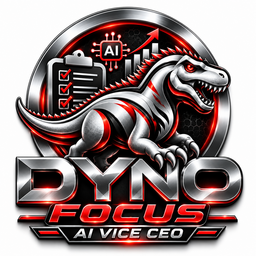

<p align="center"></p>

# Dyno Focus · AI Vice CEO

**Thinks like a CEO. Acts like a Vice CEO. The human CEO makes the final decision.**

Dyno Focus keeps one shared task database and works through three channels:

- **Executive dashboard**: top 3 priorities, pending decisions, execution progress, communications and system health.
- **Email**: an 8:30 AM executive briefing and a 6:00 PM report (Asia/Kuala_Lumpur).
- **WhatsApp** (official Meta Cloud API): ask *"Apa kerja penting hari ni?"*, reply *"Fatihah dah settle"*, *"Sediakan follow-up Derol"*, *"APPROVE K7Q2"*.

Customer messages, external emails and important changes go to the **Decision Room** and are executed only after the CEO approves them. Spending, contracts and hiring are CEO-only; the AI only prepares the decision brief.

See [`docs/AUDIT_AND_PLAN.md`](docs/AUDIT_AND_PLAN.md) for the architecture, security model and acceptance-criteria mapping.

## Quick start (development)

```bash
composer install
cp .env.example .env
php artisan key:generate
touch database/database.sqlite
php artisan migrate --seed        # demo login: ceo@dynofocus.test / password
php artisan serve                 # http://127.0.0.1:8000
php artisan queue:work            # in a second terminal: executes approvals & sends messages
php artisan test                  # 68 feature/unit tests
```

Defaults are safe for development: WhatsApp uses a **mock transport** (`WHATSAPP_DRIVER=log`), mail uses the `log` mailer, and scheduled automations are **off** (`VICE_CEO_AUTOMATIONS_ENABLED=false`). Nothing leaves the server.

## Going live

| What | Settings |
| --- | --- |
| AI (optional) | `ANTHROPIC_API_KEY` (model `VICE_CEO_AI_MODEL`, default `claude-opus-5-5`). Without it, rule-based reasoning is used. |
| Email | Any Laravel mailer: `MAIL_MAILER=smtp` (Gmail app password / Workspace relay) or `resend`, `postmark`, `ses`. |
| WhatsApp | `WHATSAPP_DRIVER=meta`, `WHATSAPP_ACCESS_TOKEN` (System User token), `WHATSAPP_PHONE_NUMBER_ID`, `WHATSAPP_APP_SECRET`, `WHATSAPP_VERIFY_TOKEN`. |
| Webhook | In Meta App → WhatsApp → Configuration, set callback URL `https://<your-domain>/webhooks/whatsapp`, the same verify token, and subscribe to `messages`. |
| Templates | Outside Meta's 24-hour window only approved templates can be sent. Create templates with one body variable `{{1}}` and set `WHATSAPP_TEMPLATE_CEO_UPDATE` / `WHATSAPP_TEMPLATE_CUSTOMER_FOLLOWUP`. |
| Scheduler | Cron: `* * * * * php /path/artisan schedule:run`, plus a supervised `php artisan queue:work`. Then set `VICE_CEO_AUTOMATIONS_ENABLED=true` and enable each automation in **Automations**. |
| CEO WhatsApp | **Settings → Your WhatsApp**: enter your number, then send `VERIFY <code>` from that phone. Only verified CEO numbers can give commands or approvals. |

## WhatsApp commands

| Message | What happens |
| --- | --- |
| `Apa kerja penting hari ni?` | Top 3 priorities from live tasks + recommendation |
| `Apa yang pending?` | Open tasks (overdue first) + decisions waiting |
| `Fatihah dah settle` / `done T-12` | Marks the matching task Completed (asks if ambiguous) |
| `Mula T-12`, `T-12 tunggu customer` | Status updates |
| `Tambah tugasan: …` | New task (duplicate-checked) |
| `Sediakan follow-up Derol` | AI drafts a message → Decision Room → preview sent to CEO |
| `APPROVE K7Q2` / `REJECT K7Q2` / buttons | Decide; executes once, logged |
| `UBAH K7Q2: <new text>` | New draft version; must be approved again |
